# Adaptive Flashcard Application — Data Dictionary & ERD (DEL-004)

This document provides the authoritative data dictionary, entity-relationship diagram, row-level security (RLS) policies, and remote procedure call (RPC) specifications for the Adaptive Flashcard Application (FCA-SRS-001, FCA-VVP-001).

---

## 1. Entity-Relationship Diagram (ERD)

```mermaid
erDiagram
    PROFILES ||--|| USERS : "extends (1:1)"
    USERS ||--o{ DECKS : "owns"
    DECKS ||--o{ IMPORT_BATCHES : "receives"
    DECKS ||--o{ CARDS : "contains"
    IMPORT_BATCHES ||--o{ CARDS : "imports"
    USERS ||--o{ STUDY_SESSIONS : "conducts"
    DECKS ||--o{ STUDY_SESSIONS : "studied in"
    STUDY_SESSIONS ||--o{ SESSION_CARD_STATE : "tracks"
    CARDS ||--o{ SESSION_CARD_STATE : "evaluated in"
    STUDY_SESSIONS ||--o{ REVIEW_EVENTS : "records"
    CARDS ||--o{ REVIEW_EVENTS : "reviewed by"
    STUDY_SESSIONS ||--o{ SELECTION_EVENTS : "logs selection"
    CARDS ||--o{ SELECTION_EVENTS : "selected"
    STUDY_SESSIONS ||--o{ GRADE_OPERATIONS : "operates in"
    CARDS ||--o{ GRADE_OPERATIONS : "graded by"
    REVIEW_EVENTS ||--o| GRADE_OPERATIONS : "persists operation"

    PROFILES {
        uuid id PK
        uuid user_id FK
        float default_desired_retention
        int default_cohort_size
        float default_new_learning_fraction
        timestamptz created_at
        timestamptz updated_at
    }

    DECKS {
        uuid id PK
        uuid user_id FK
        text name
        text description
        timestamptz exam_date
        float desired_retention
        int cohort_size
        float new_learning_fraction
        int min_failed_retry_delay_seconds
        int min_intervening_cards
        boolean is_archived
        timestamptz created_at
        timestamptz updated_at
    }

    IMPORT_BATCHES {
        uuid id PK
        uuid user_id FK
        uuid deck_id FK
        uuid operation_id UK
        text file_name
        int total_rows
        int inserted_count
        int skipped_duplicate_count
        int rejected_count
        timestamptz created_at
    }

    CARDS {
        uuid id PK
        uuid user_id FK
        uuid deck_id FK
        uuid import_batch_id FK
        int source_row_number
        text question_text
        text answer_text
        text normalized_question
        text normalized_answer
        text content_hash UK
        timestamptz first_imported_at
        int cohort_number
        int source_order
        float importance_weight
        text learning_state
        float difficulty
        float stability_days
        timestamptz last_review_at
        timestamptz next_due_at
        int last_rating
        text algorithm_version
        int review_count
        int correct_count
        int incorrect_count
        int lapse_count
        timestamptz last_correct_at
        timestamptz last_incorrect_at
        int successful_relearning_sessions
        float percent_correct
        timestamptz suspended_at
        timestamptz archived_at
        timestamptz created_at
        timestamptz updated_at
    }

    STUDY_SESSIONS {
        uuid id PK
        uuid user_id FK
        uuid deck_id FK
        int duration_seconds
        text status
        timestamptz started_at
        timestamptz ended_at
        float active_duration_seconds
        jsonb settings_snapshot
        int cards_reviewed
        int correct_count
        int incorrect_count
        int new_cards_introduced
        int due_cards_completed
        timestamptz created_at
    }

    SESSION_CARD_STATE {
        uuid id PK
        uuid session_id FK
        uuid card_id FK
        uuid user_id FK
        boolean has_met_criterion
        boolean has_unresolved_failure
        timestamptz last_failure_at
        int intervening_cards_since_failure
        boolean introduced_in_session
        timestamptz created_at
    }

    REVIEW_EVENTS {
        uuid id PK
        uuid card_id FK
        uuid deck_id FK
        uuid user_id FK
        uuid session_id FK
        uuid operation_id
        timestamptz shown_at
        timestamptz revealed_at
        timestamptz rated_at
        text result
        int rating
        float valid_duration_seconds
        boolean is_interrupted
        text pre_learning_state
        float pre_difficulty
        float pre_stability_days
        timestamptz pre_due_at
        text post_learning_state
        float post_difficulty
        float post_stability_days
        timestamptz post_due_at
        text algorithm_version
        timestamptz invalidated_at
        text invalidation_reason
        uuid superseding_operation_id
        timestamptz created_at
    }

    SELECTION_EVENTS {
        uuid id PK
        uuid user_id FK
        uuid session_id FK
        uuid selected_card_id FK
        text policy_version
        timestamptz timestamp
        text seed
        text selected_queue
        jsonb candidate_ids
        jsonb utility_values
        timestamptz created_at
    }

    GRADE_OPERATIONS {
        uuid id PK
        uuid operation_id UK
        uuid user_id FK
        uuid session_id FK
        uuid card_id FK
        uuid review_event_id FK
        jsonb result_json
        text status
        timestamptz created_at
    }
```

---

## 2. Table Catalog

### 2.1 `profiles`
User-level configuration defaults extending Supabase `auth.users`.
- **Primary Key**: `id` (`UUID`, references `auth.users(id) ON DELETE CASCADE`)
- **Foreign Keys**: `user_id` (`UUID`, references `auth.users(id) ON DELETE CASCADE`)
- **Columns**:
  - `default_desired_retention` (`DOUBLE PRECISION`, NOT NULL, DEFAULT 0.90, CHECK `0.70 <= x <= 0.97`)
  - `default_cohort_size` (`INTEGER`, NOT NULL, DEFAULT 10, CHECK `5 <= x <= 20`)
  - `default_new_learning_fraction` (`DOUBLE PRECISION`, NOT NULL, DEFAULT 0.30, CHECK `0.00 <= x <= 0.50`)
  - `created_at` (`TIMESTAMPTZ`, NOT NULL, DEFAULT `NOW()`)
  - `updated_at` (`TIMESTAMPTZ`, NOT NULL, DEFAULT `NOW()`)

### 2.2 `decks`
Collection of flashcards associated with an owner and study settings.
- **Primary Key**: `id` (`UUID`, DEFAULT `gen_random_uuid()`)
- **Foreign Keys**: `user_id` (`UUID`, references `auth.users(id) ON DELETE CASCADE`)
- **Columns & Constraints**:
  - `name` (`TEXT`, NOT NULL)
  - `description` (`TEXT`, NULL)
  - `exam_date` (`TIMESTAMPTZ`, NULL)
  - `desired_retention` (`DOUBLE PRECISION`, NOT NULL, DEFAULT 0.90, CHECK `0.70 <= x <= 0.97`)
  - `cohort_size` (`INTEGER`, NOT NULL, DEFAULT 10, CHECK `5 <= x <= 20`)
  - `new_learning_fraction` (`DOUBLE PRECISION`, NOT NULL, DEFAULT 0.30, CHECK `0.00 <= x <= 0.50`)
  - `min_failed_retry_delay_seconds` (`INTEGER`, NOT NULL, DEFAULT 60, CHECK `>= 0`)
  - `min_intervening_cards` (`INTEGER`, NOT NULL, DEFAULT 3, CHECK `>= 0`)
  - `is_archived` (`BOOLEAN`, NOT NULL, DEFAULT `FALSE`)
  - `created_at` (`TIMESTAMPTZ`, NOT NULL, DEFAULT `NOW()`)
  - `updated_at` (`TIMESTAMPTZ`, NOT NULL, DEFAULT `NOW()`)

### 2.3 `import_batches`
Audit trail of CSV import operations for idempotency and duplicate tracking.
- **Primary Key**: `id` (`UUID`, DEFAULT `gen_random_uuid()`)
- **Foreign Keys**:
  - `user_id` (`UUID`, references `auth.users(id) ON DELETE CASCADE`)
  - `deck_id` (`UUID`, references `decks(id) ON DELETE CASCADE`)
- **Constraints**: UNIQUE `(user_id, operation_id)`
- **Columns**:
  - `operation_id` (`UUID`, NOT NULL)
  - `file_name` (`TEXT`, NULL)
  - `total_rows` (`INTEGER`, NOT NULL, DEFAULT 0)
  - `inserted_count` (`INTEGER`, NOT NULL, DEFAULT 0)
  - `skipped_duplicate_count` (`INTEGER`, NOT NULL, DEFAULT 0)
  - `rejected_count` (`INTEGER`, NOT NULL, DEFAULT 0)
  - `created_at` (`TIMESTAMPTZ`, NOT NULL, DEFAULT `NOW()`)

### 2.4 `cards`
Flashcard units of study containing text, normalization hashes, and FSRS memory state.
- **Primary Key**: `id` (`UUID`, DEFAULT `gen_random_uuid()`)
- **Foreign Keys**:
  - `user_id` (`UUID`, references `auth.users(id) ON DELETE CASCADE`)
  - `deck_id` (`UUID`, references `decks(id) ON DELETE CASCADE`)
  - `import_batch_id` (`UUID`, references `import_batches(id) ON DELETE SET NULL`)
- **Constraints**:
  - UNIQUE `(user_id, deck_id, content_hash)` (enforces duplicate prevention within a deck)
  - CHECK `correct_count + incorrect_count = review_count` (DAT-006 counter equality)
  - CHECK `importance_weight > 0`
  - CHECK `learning_state IN ('new', 'learning', 'review', 'relearning', 'suspended')`
  - `percent_correct`: GENERATED ALWAYS AS `(CASE WHEN review_count = 0 THEN 0.0 ELSE (correct_count::DOUBLE PRECISION / review_count::DOUBLE PRECISION * 100.0) END) STORED` (DAT-012, DAT-013)
- **Indexes**:
  - `idx_cards_deck_user` on `(deck_id, user_id)`
  - `idx_cards_due` on `(deck_id, learning_state, next_due_at)`

### 2.5 `study_sessions`
Discrete study session executions with frozen settings snapshot and counters.
- **Primary Key**: `id` (`UUID`, DEFAULT `gen_random_uuid()`)
- **Foreign Keys**:
  - `user_id` (`UUID`, references `auth.users(id) ON DELETE CASCADE`)
  - `deck_id` (`UUID`, references `decks(id) ON DELETE CASCADE`)
- **Constraints**:
  - CHECK `duration_seconds >= 60 AND duration_seconds <= 14400`
  - CHECK `status IN ('active', 'completed', 'ended_early')`
- **Columns**:
  - `duration_seconds` (`INTEGER`, NOT NULL)
  - `status` (`TEXT`, NOT NULL, DEFAULT 'active')
  - `started_at` (`TIMESTAMPTZ`, NOT NULL, DEFAULT `NOW()`)
  - `ended_at` (`TIMESTAMPTZ`, NULL)
  - `active_duration_seconds` (`DOUBLE PRECISION`, NOT NULL, DEFAULT 0)
  - `settings_snapshot` (`JSONB`, NOT NULL)
  - `cards_reviewed`, `correct_count`, `incorrect_count`, `new_cards_introduced`, `due_cards_completed` (`INTEGER`, NOT NULL, DEFAULT 0)

### 2.6 `session_card_state`
Intra-session temporary state tracking mastery criteria and failure spacing per session card.
- **Primary Key**: `id` (`UUID`, DEFAULT `gen_random_uuid()`)
- **Constraints**: UNIQUE `(session_id, card_id)`
- **Columns**:
  - `session_id` (`UUID`, references `study_sessions(id) ON DELETE CASCADE`)
  - `card_id` (`UUID`, references `cards(id) ON DELETE CASCADE`)
  - `user_id` (`UUID`, references `auth.users(id) ON DELETE CASCADE`)
  - `has_met_criterion` (`BOOLEAN`, NOT NULL, DEFAULT FALSE)
  - `has_unresolved_failure` (`BOOLEAN`, NOT NULL, DEFAULT FALSE)
  - `last_failure_at` (`TIMESTAMPTZ`, NULL)
  - `intervening_cards_since_failure` (`INTEGER`, NOT NULL, DEFAULT 0)
  - `introduced_in_session` (`BOOLEAN`, NOT NULL, DEFAULT FALSE)

### 2.7 `review_events`
Append-only log of card evaluations (DAT-010). Protected by trigger `trg_review_events_append_only`.
- **Primary Key**: `id` (`UUID`, DEFAULT `gen_random_uuid()`)
- **Foreign Keys**:
  - `card_id` (`UUID`, references `cards(id) ON DELETE RESTRICT`)
  - `deck_id` (`UUID`, references `decks(id) ON DELETE RESTRICT`)
  - `user_id` (`UUID`, references `auth.users(id) ON DELETE CASCADE`)
  - `session_id` (`UUID`, references `study_sessions(id) ON DELETE SET NULL`)
- **Constraints**:
  - CHECK `result IN ('correct', 'incorrect')`
  - Append-only trigger prevents mutation of historical data; only `invalidated_at`, `invalidation_reason`, and `superseding_operation_id` can be updated during undo operations.

### 2.8 `selection_events`
Deterministic audit log of card selection algorithm choices (SCH-039).
- **Primary Key**: `id` (`UUID`, DEFAULT `gen_random_uuid()`)
- **Columns**:
  - `policy_version` (`TEXT`, NOT NULL)
  - `timestamp` (`TIMESTAMPTZ`, NOT NULL, DEFAULT `NOW()`)
  - `seed` (`TEXT`, NOT NULL)
  - `selected_queue` (`TEXT`, NOT NULL)
  - `candidate_ids` (`JSONB`, NOT NULL)
  - `utility_values` (`JSONB`, NOT NULL)

### 2.9 `grade_operations`
Idempotency table recording atomic grade mutations and undos.
- **Primary Key**: `id` (`UUID`, DEFAULT `gen_random_uuid()`)
- **Constraints**: UNIQUE `(user_id, operation_id)`
- **Columns**:
  - `operation_id` (`UUID`, NOT NULL)
  - `session_id` (`UUID`, references `study_sessions(id) ON DELETE CASCADE`)
  - `card_id` (`UUID`, references `cards(id) ON DELETE CASCADE`)
  - `review_event_id` (`UUID`, references `review_events(id) ON DELETE SET NULL`)
  - `result_json` (`JSONB`, NOT NULL)
  - `status` (`TEXT`, NOT NULL, DEFAULT 'committed', CHECK `status IN ('committed', 'undone')`)

---

## 3. Row-Level Security (RLS) Model

All public tables enforce strict multi-tenant isolation via PostgreSQL RLS:
1. `ALTER TABLE <table_name> ENABLE ROW LEVEL SECURITY;`
2. `ALTER TABLE <table_name> FORCE ROW LEVEL SECURITY;`
3. Policies enforce `auth.uid() = user_id` for both `USING` and `WITH CHECK` clauses.
4. Anonymous users cannot read or modify any private rows (SEC-001..SEC-003).

---

## 4. Remote Procedure Calls (RPCs)

All RPC functions are defined with:
- `SECURITY DEFINER`
- Fixed `search_path = public, auth` (preventing search-path spoofing attacks, SEC-005, SEC-006)
- Strict `auth.uid()` authentication check

### 4.1 `rpc_submit_grade`
- **Parameters**: `(p_operation_id UUID, p_session_id UUID, p_card_id UUID, p_rating INTEGER, p_result TEXT, p_shown_at TIMESTAMPTZ, p_revealed_at TIMESTAMPTZ, p_rated_at TIMESTAMPTZ, p_valid_duration DOUBLE PRECISION, p_is_interrupted BOOLEAN, p_post_state JSONB, p_algorithm_version TEXT)`
- **Returns**: `JSONB`
- **Semantics**:
  - Idempotency check against `grade_operations`.
  - Atomically records `review_events` row.
  - Updates `cards` memory attributes, timestamps, counters, and lapses.
  - Increments `study_sessions` statistics.
  - Inserts audit record into `grade_operations`.

### 4.2 `rpc_undo_grade`
- **Parameters**: `(p_undo_operation_id UUID, p_session_id UUID, p_target_operation_id UUID, p_reason TEXT)`
- **Returns**: `JSONB`
- **Semantics**:
  - Rejects undo if another grade has committed since target operation (REV-013).
  - Restores previous card state from `review_events.pre_*` attributes.
  - Invalidates review event (`invalidated_at = NOW()`, `invalidation_reason`, `superseding_operation_id`).
  - Reverses `study_sessions` counter increments.
  - Marks grade operation `undone`.

### 4.3 `rpc_commit_import`
- **Parameters**: `(p_operation_id UUID, p_deck_id UUID, p_file_name TEXT, p_total_rows INTEGER, p_cards JSONB)`
- **Returns**: `JSONB`
- **Semantics**:
  - Idempotent execution based on `(user_id, operation_id)`.
  - Creates `import_batches` entry.
  - Evaluates SHA-256 `content_hash` against existing active cards in target deck.
  - Skips duplicates within target deck (`skipped_duplicate_count`).
  - Atomically inserts new unique cards with cohort ordering.

### 4.4 `rpc_delete_deck`
- **Parameters**: `(p_deck_id UUID)`
- **Returns**: `BOOLEAN`
- **Semantics**:
  - Verifies deck ownership for authenticated caller.
  - Deletes all review events associated with the deck.
  - Deletes the deck record, cascading to cards, study sessions, and import batches.

### 4.5 `rpc_delete_card`
- **Parameters**: `(p_card_id UUID)`
- **Returns**: `BOOLEAN`
- **Semantics**:
  - Verifies card ownership for authenticated caller.
  - Explicitly deletes review events for the card to satisfy foreign key `ON DELETE RESTRICT` constraint.
  - Deletes the card record, cleanly cascading to session card state, selection events, and grade operations.
